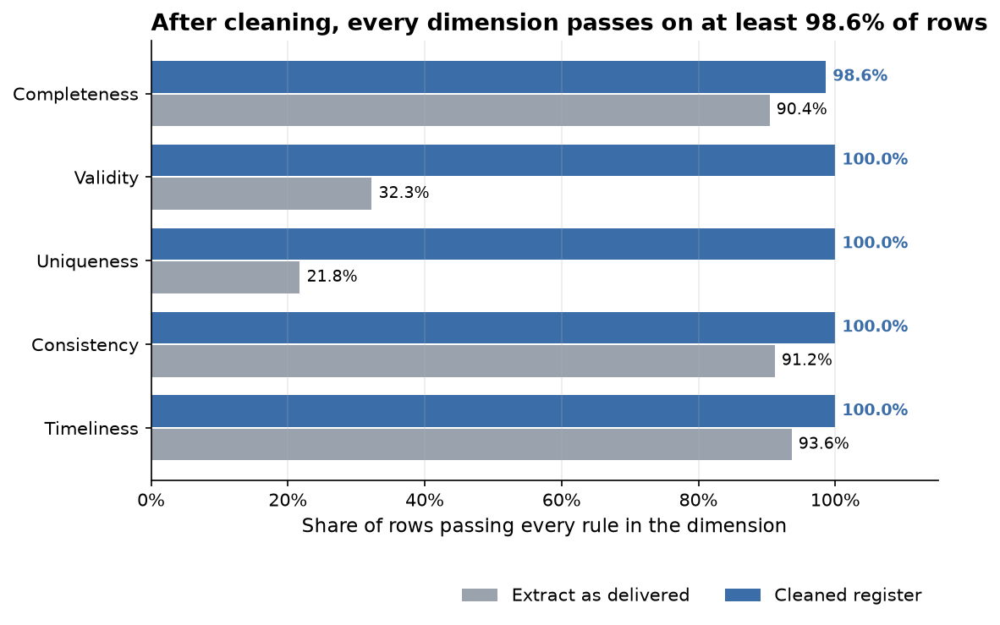
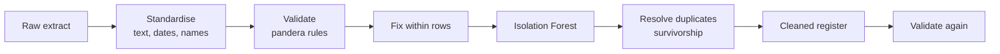
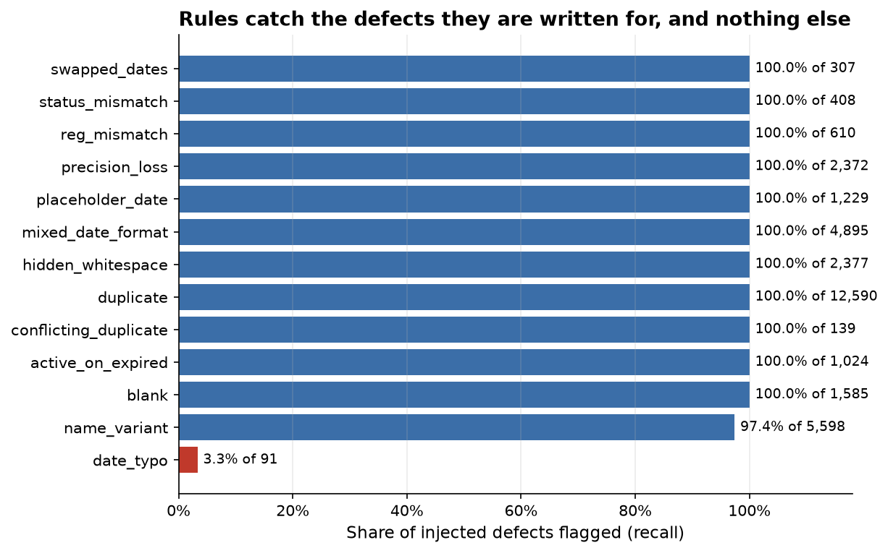
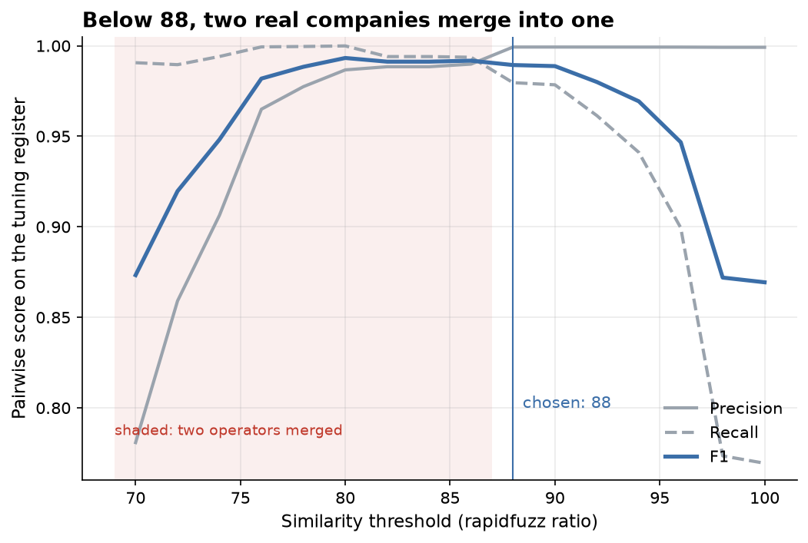
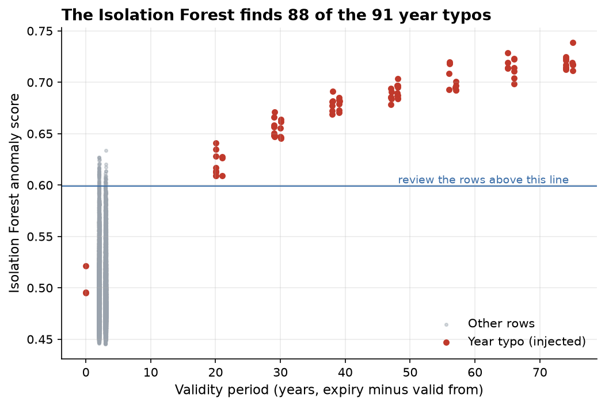
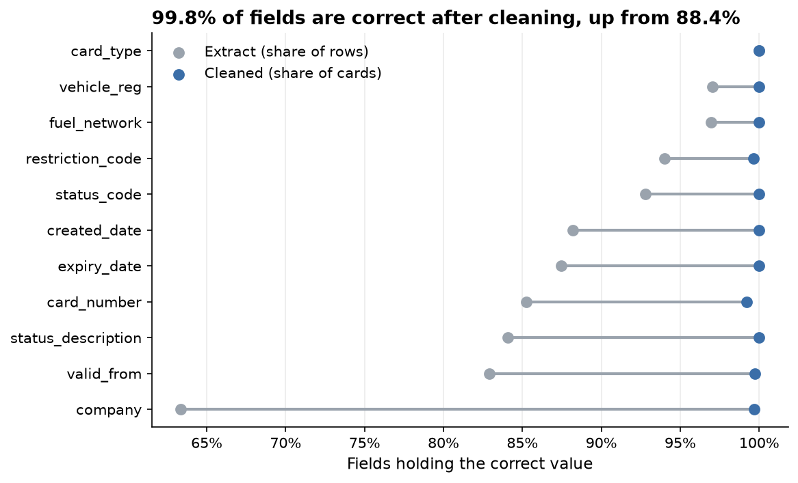

# How reliably can an automated pipeline detect and fix the quality defects in a fleet fuel card register?

[](https://github.com/LA-VS/fleet-data-quality/actions/workflows/ci.yml)

**Very reliably for the defects it is written for. The pipeline flagged 99.3% of 33,225 injected defects with 99.97% precision, and 99.8% of fields in the cleaned register are correct, up from 88.4% in the raw extract.**
What it cannot fix is where the information is gone: 28 card numbers rounded by Excel in every copy, and a company name truncated into another company's name.



## Why the data is generated

The original exercise used a training provider's file, which is not published here. Instead, [`generate.py`](src/fleet_dq/generate.py) builds a clean register of 3,500 fuel cards for 26 invented fleet operators, repeats and damages it into a 16,090 row extract, and **logs every change it makes**. Because the right answer is known, the pipeline is scored with precision and recall instead of judged by eye.

| Defect | Injected | What it looks like |
|---|---:|---|
| Duplicate rows | 12,590 | Each card appears 4.6 times on average, as when several exports are merged |
| Conflicting duplicates | 139 | An older copy of a stopped or cancelled card still says Active |
| Company name variants | 5,598 | `Penrowan FRT Services Limited`, `PENROWAN FREIGHT SERVS LTD`, `Penrowan Fregiht Ser` |
| Mixed date formats | 4,895 | `31/07/2026`, `07/26` and `2026-07-31T00:00:00` in one column |
| Hidden whitespace | 2,377 | Non breaking spaces and padding inside text |
| Excel precision loss | 2,372 | 18 digit card numbers with the last three digits zeroed |
| Blanks | 1,585 | Missing status descriptions and restriction codes |
| Placeholder dates | 1,229 | `01/01/1990` as the valid from date |
| Active on an expired card | 1,024 | Status not updated after expiry |
| Registration mismatch | 610 | The embossed registration disagrees with the vehicle field |
| Status code against description | 408 | Code `S`, description `Active` |
| Swapped dates | 307 | Expiry before creation |
| Year typos | 91 | `2027` keyed as `2072`. No rule is written for these, as a test of the anomaly model |

All names, card numbers and registrations are invented; any resemblance to a real company is coincidental.

## How to run it

Needs [uv](https://docs.astral.sh/uv/). Everything else, including Python 3.12, is installed from the lock file.

```
git clone https://github.com/LA-VS/fleet-data-quality.git
cd fleet-data-quality
uv sync
uv run pytest
uv run python scripts/clean_register.py
uv run jupyter nbconvert --execute --to notebook --inplace notebooks/fleet_data_quality.ipynb
```

The generated data are committed in `data/raw/`: the extract, and the ground truth in `data/raw/ground_truth/`.
`uv run python scripts/generate_data.py` regenerates them identically (fixed seed), and a test checks that it does.
`clean_register.py` writes the cleaned register and every flag to `data/processed/`.

## Method



* **Profiling** comes first: completeness, distinct counts and value shapes per column, which is where the rules come from.
* **Rule based validation** uses two pandera schemas: formats on the extract as delivered, then logic on the standardised rows (dates in order, status code against description, the two registration fields, the placeholder date, card numbers that pass the Luhn check).
* **Fuzzy matching** with rapidfuzz clusters company spellings after normalising them (case, punctuation, abbreviations such as `SERVS`, legal suffixes). The threshold is tuned on a **separately generated register**, so the reported register never influences it.
* **Entity resolution** collapses duplicate rows. A rounded card number is matched back to a full one only when exactly one full number shares its first fifteen digits **and** its vehicle registration, because cards on one account share their first fifteen digits.
* **Survivorship** decides which value wins. Status comes from the latest row, because it is the field that changes over a card's life. Every other field takes the most common value across the card's rows, with ties going to the latest row. Rows the anomaly model flags vote only when nothing else can.
* **Anomaly detection** runs an Isolation Forest over five date features and flags 1% of rows for review.
* **The scorecard** covers completeness, validity, uniqueness, consistency and timeliness, running the same rules on the extract and on the cleaned register.

## Findings

1. **Rules catch what they are written for, and nothing else.** Every defect type with a rule is caught in full, apart from name variants (97.4%). Year typos are real dates in the right format, so the rules catch only the 3 of 91 that land on a day that does not exist (29 February 2082).

   

2. **The best F1 threshold for name matching merges two real companies.** On the tuning register, pairwise F1 peaks at 80, but from 80 to 86 Silvermead Logistics and Silvermead Logistics North become one. A merge hides a customer inside another, while an unmatched spelling stays visible, so the threshold is the best F1 with no merges: **88**. On the reported register that gives 99.0% pairwise precision, 98.1% recall and no merged operators.

   

3. **Some names cannot be matched by any measure.** "Silvermead Logistics North Ltd" cut to a 20 character field becomes exactly "Silvermead Logistics", the other company, so 103 rows are matched to the wrong operator. Survivorship still gives most of those cards the right name, because their other rows carry it: 99.7% of cards end up with the right company.

4. **Duplicates resolve perfectly, and most rounded numbers come back.** The 16,090 rows collapse to exactly the 3,500 real cards. Of 2,379 rows with a rounded number, 2,331 are recovered from another copy. The 28 cards where every copy was rounded keep a blank number rather than a guess.

5. **The Isolation Forest finds 88 of the 91 year typos** among 161 flagged rows. The 3 it misses are the impossible dates the rules catch, so together they find every one. Of the other 73 flagged rows, 57 carry some other defect and 16 are clean but unusual. Its flags also feed survivorship, which keeps a typo out of 2 cards' expiry dates.

   

6. **Field accuracy rises from 88.4% to 99.8%.** A scorecard can be gamed by blanking bad values, so each cleaned record is also compared with the truth. What remains wrong is what the data no longer holds: 28 card numbers, 12 restriction codes and 10 valid from dates that are blank in every copy, and the truncated company names.

   

### Excel against the pipeline

| | Hand cleaning in Excel | This pipeline |
|---|---|---|
| Time | Hours for one file, and again next month | Seconds per run once written; writing it took days |
| Repeatability | Depends on remembering every step | Same input, same output |
| Auditability | Edits overwrite the original | Raw file untouched; every flag and fix logged with its rule |
| Card numbers | Opening the file can itself cause the 15 digit rounding | Read as text, so the damage cannot happen |
| Judgement calls | Made case by case | Written down once as survivorship rules |
| Unknown problems | A person may notice something odd | Only what the rules and the anomaly model look for |
| Measurement | No way to know how accurate the result is | Scored against ground truth |

Excel is still quicker for a one off look at a small file. The pipeline wins once the file recurs, is large, or has to be trusted by someone else.

## Limitations

* **The generator and the pipeline share an author.** The defect types were known in advance, so the rule scores are an upper bound. The fairer tests are the parts that do not depend on that knowledge: the name threshold, tuned on a separate register; number recovery; and the anomaly model.
* **Synthetic data is tidier than real data.** A real register has defects nobody listed, and defects that combine in more ways.
* **The abbreviation list was written from the variants**, as an analyst would after profiling. A new abbreviation falls to the fuzzy matcher, which handles some and not others.
* **The Isolation Forest finds what is unusual, not what is wrong.** A typo that moves a year by one would look normal.

## Next steps

* Run the pipeline on registers generated with higher defect rates, to see where each method breaks down.
* Replace the single name threshold with a review queue: accept matches above 95 automatically and send those between 88 and 95 to a person.
* Propose rules from the profile automatically, so the rules do not depend on knowing the defects first.

## Repo layout

```
data/raw/                 the generated extract and its ground truth
src/fleet_dq/             generate, clean, rules, names, resolve, anomaly, scorecard, evaluate
notebooks/                the narrative notebook, outputs saved
reports/figures/          charts used in this README
tests/                    pytest for every module and for the committed data
scripts/                  generate the data, run the pipeline
```

## Origin

This project began as the Excel data quality challenge in my Level 4 Data Analyst apprenticeship and was rebuilt to a professional standard:
generated data with a known answer in place of a file that cannot be shared, a tested pipeline in place of manual steps, and every result measured against ground truth.
